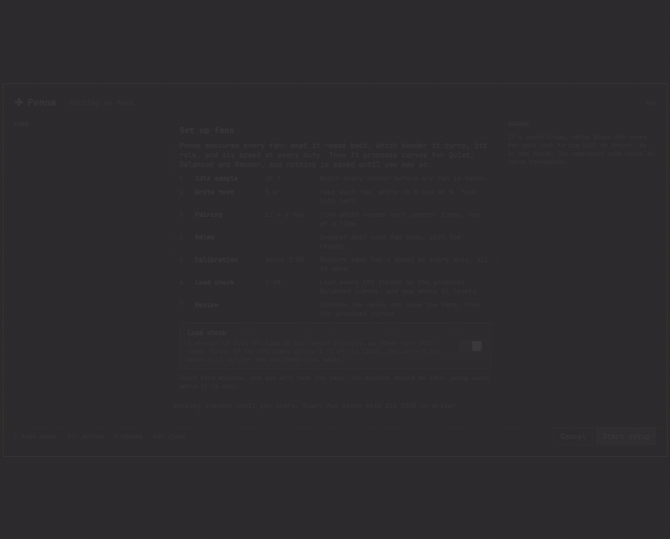
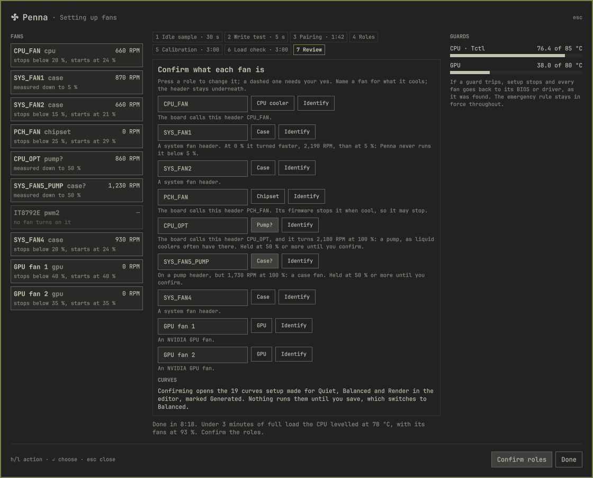
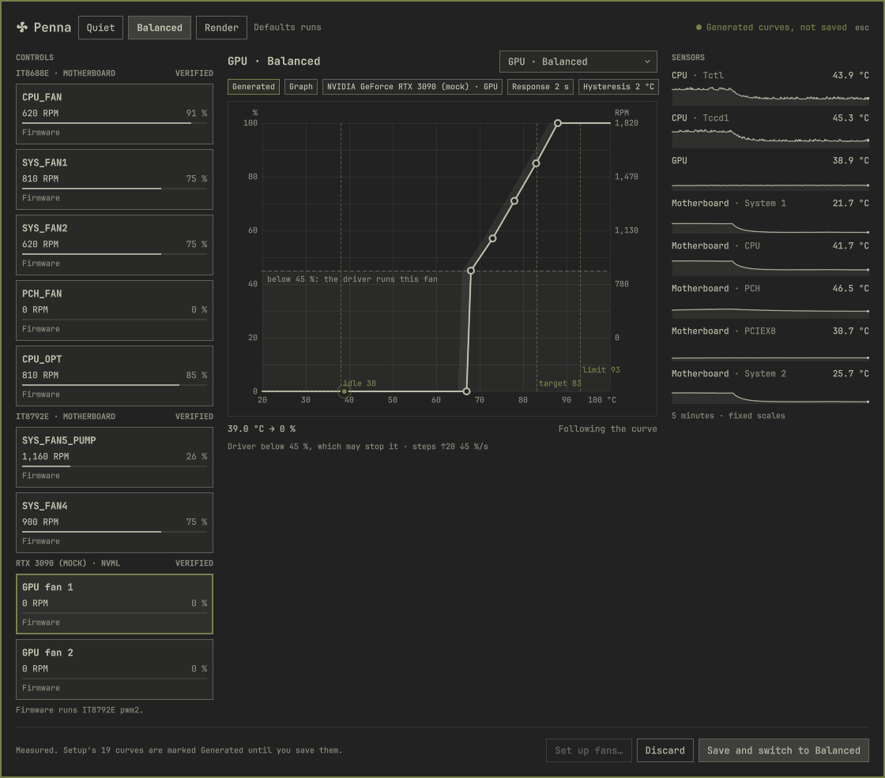
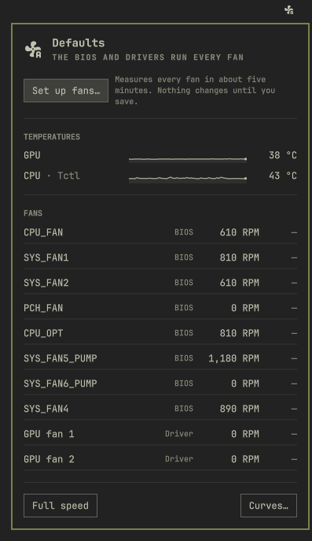
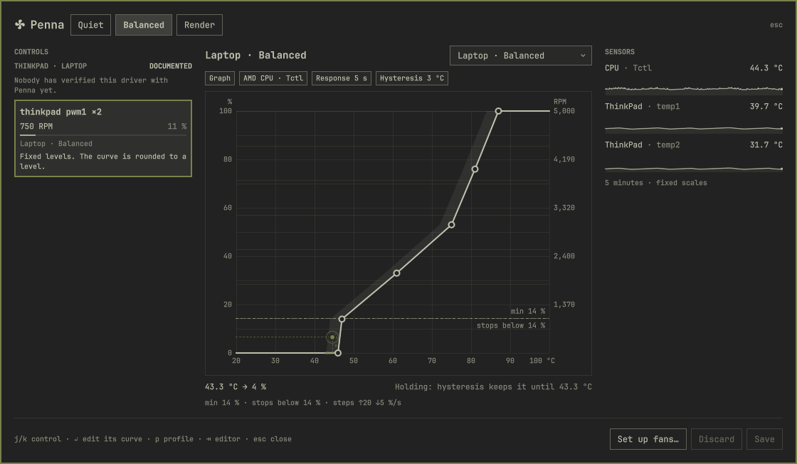
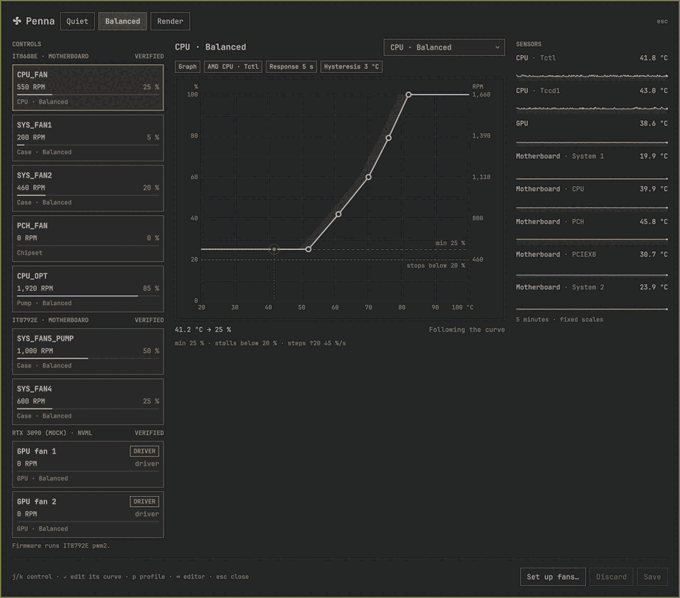

# Penna

Fan control for Linux, made to be understood.

Penna is a daemon (`pennad`), a command line (`penna`) and a shell plugin for [Omarchy](https://omarchy.org). It names every
fan for what it cools, shows its RPM beside what it was asked for, and says plainly what a machine can't do. It drives fans
only through the kernel's own drivers, hwmon and NVIDIA's NVML, and never touches a chip from userspace.

- **Every fan goes back.** Before Penna changes a fan it writes down how to put it back. A clean stop, a crash, `kill -9`, a
  hung loop caught by systemd's watchdog, and removing the package all return each fan to its BIOS or driver. *Defaults*, the
  first profile, does the same whenever you choose it.
- **Setup measures, then proposes.** One automatic run of about five minutes writes to every fan, finds which header drives
  which tach, and suggests each fan's role: CPU cooler, pump, chipset, case or GPU. It measures where each fan stops and starts
  and how fast it spins. Then it proposes Quiet, Balanced and Render curves for you to review. Nothing is kept until you press
  *Save*.
- **Plain words.** Each fan says what kind of control it has (a duty, fixed levels, a target speed, a curve the firmware runs,
  or only automatic and full speed), and how well Penna knows its driver.

The design, and the reasoning behind every rule, is in [DESIGN.md](DESIGN.md).


## What it looks like

Everything here is the real plugin, recorded against a simulation of the desk Penna was built on: a Gigabyte X570 AORUS PRO
with seven fans on two ITE chips, and an RTX 3090. The simulation runs twenty times faster than real time, so fans settle
sooner than they would.

### The popup


Click the fan glyph in the bar. The popup is for every day: the profiles, the temperatures the curves follow, and every fan
with its role, RPM and duty. A bar under each fan shows its duty at a glance.

Profiles switch at once, and fans glide to their new curves at the step rate. *Full speed* puts every fan at 100 % until you
turn it off, and the glyph says so while it lasts.

*Defaults*, the first pill, hands every fan back to its BIOS or driver, and keeps it there.

*Curves…* opens the studio.
<br clear="right">

### The studio

Curves are edited in the studio, as in the GIF at the top. There is one card per fan, under its chip, with how well Penna
knows the driver. The editor draws each fan's own limits: where it stalls, its floor, and its RPM on the right-hand scale,
from what setup measured. Drag a point and the fan follows it live, as a draft. *Save* keeps it, and *Discard* puts it back.
Five minutes of every sensor run down the right.

### Setup



*Set up fans…* measures every fan in one automatic run: about five minutes, then three more for the load check. The GIF runs
it about thirty times faster:
1. An idle sample, then a write test of each control.
2. Pairing finds which tach each header drives.
3. Calibration steps every fan down from 100 % and draws each one's RPM on its own scale.
4. Three minutes of full CPU load check the curves it proposes.

Guards stop it if anything runs hot, and every fan goes back as it was found.



The review suggests a role for each fan and says why. A fan on a pump header that spins like a case fan waits for your yes.
Confirming opens the curves setup made, marked *Generated*, with their anchors on the axis: the idle temperature, the target
and the limit.



### A fresh install



Penna starts in *Defaults*: the BIOS and the drivers keep running every fan, and the popup lists each one by its header, with
who runs it. Nothing changes until setup's curves are saved.
<br clear="right">

### Laptops



A ThinkPad's fan has 8 fixed levels, so the editor draws the levels and the curve is rounded to one. Its card says the driver is
*Documented*: built from the kernel's source, and not yet run on the hardware.

### It follows your theme



Every colour, size and spacing comes from the shell's theme tokens, light themes as well as dark. Motion follows Hyprland's
`animations:enabled`.

### From the terminal

`penna state` on that desk, for real:

```
Penna · Balanced · 9 fans                              via /run/penna/penna.sock

Temperatures
  AMD CPU · Tctl                   51.9 °C
  NVIDIA GeForce RTX 3090 · GPU    47.0 °C
  Motherboard · CPU                50.0 °C
  Motherboard · VRM MOS            34.0 °C
  Motherboard · PCH                48.0 °C
  …

Fans
  CPU_FAN                  605 RPM    26 %          CPU · Balanced
  SYS_FAN1                 853 RPM     5 %          Case · Balanced
  SYS_FAN2                 382 RPM    15 %          Case · Balanced
  PCH_FAN                    0 RPM     0 %          Chipset
  CPU_OPT                1,901 RPM    85 %          Pump · Balanced
  SYS_FAN5_PUMP            425 RPM    15 %          Case · Balanced
  SYS_FAN4                 867 RPM    30 %          Case · Balanced
  GPU fan 1                  0 RPM                  GPU · Balanced · below 45 %: the driver's curve runs it
  GPU fan 2                  0 RPM                  GPU · Balanced · below 50 %: the driver's curve runs it
```

`penna doctor` says what stands between a machine and Penna running its fans, with one thing to do about each:

```
✓ daemon       pennad 0.10.1 runs at /run/penna/penna.sock, and you can change fans.
✓ fans         No fan needs attention.
✓ motherboard  IT8688E (it8688_4008090b) is bound, with 5 fan controls Penna can drive. Its driver is Verified: …
✓ motherboard  IT8792E (it8792_4008090b) is bound, with 3 fan controls Penna can drive. Its driver is Verified: …
· board        Gigabyte Technology Co., Ltd. X570 AORUS PRO is in Penna's board database: its headers and sensors are named.
✓ other tools  No other fan daemon is running (coolercontrold, fan2go, fancontrol, thinkfan, nbfc_service).
✓ nvidia       NVML sees NVIDIA GeForce RTX 3090 (2 fans).

Nothing needs attention.
```

## Status

This is the first public release, 0.10. Penna runs every day on the desk it was built on: a Gigabyte X570 AORUS PRO, whose
ITE IT8688E and IT8792E chips run seven fans through the [it87 fork](https://github.com/frankcrawford/it87), plus an RTX 3090
through NVML. Every way out has been tested on that hardware.

Everything else is built from the kernel's source and documentation and tested in a simulator, on a model of each driver:

<!-- generated: drivers -->
| Driver | Hardware | Penna can | Tier |
|---|---|---|---|
| NVML | NVIDIA GPUs, NVIDIA's own driver (520 or newer) | set a duty | Verified |
| `it87` | Motherboards (Super I/O chips) | set a duty | Verified |
| `nct6775`, `nct6683`, `f71882fg`, `w83627ehf` | Motherboards (Super I/O chips) | set a duty | Documented |
| `amdgpu` | AMD GPU | set a duty, or write its OverDrive curve where `pwm1` is read-only (RDNA4) | Documented |
| `nouveau` | NVIDIA GPU (nouveau) | set a duty | Documented |
| `gpd-fan` | GPD handheld | set a duty | Documented |
| `cros_ec_hwmon` | Embedded controller | set a duty | Documented |
| `acer-wmi` | Acer laptop | set a duty | Documented |
| `thinkpad_acpi` | ThinkPad | pick one of 8 levels, under the firmware's watchdog | Documented |
| `dell-smm-hwmon` | Dell laptop | pick one of 3 levels | Documented |
| `asus-wmi` | ASUS laptop | automatic or full speed; a duty where the channel has one | Documented |
| `asus-wmi custom fan curves` | ASUS fan curves | write the firmware's 8-point curve | Documented |
| `hp-wmi` | HP laptop | automatic or full speed | Documented |
| `alienware-wmi` | Alienware | read only | Documented |
| `lenovo-wmi-other` | Lenovo laptop | set a target speed | Documented |
| `applesmc` | Mac | set a target speed | Documented |
| `legion-laptop` | Lenovo Legion | read only | Documented |
| `acpi-fan` | ACPI fan | read only | Documented |
| others | System76, Surface, Intel GPUs (`i915`, `xe`), MSI laptops | read only | Documented |
<!-- end: drivers -->

On a laptop whose fans Penna can't drive, its profiles switch the power profile instead, through power-profiles-daemon.

*Documented* means nobody has run Penna on that hardware yet. If you have one of these machines, a [machine
report](CONTRIBUTING.md#a-machine-report) is the most useful thing you can send.

### Will it work on my machine?

Penna supports a machine through its fan chip's driver, not board by board. **[docs/SUPPORT.md](docs/SUPPORT.md)** has the
details:
- every chip each motherboard driver handles;
- the boards Penna knows by name;
- the sensors it reads;
- the systems it runs on: Linux with systemd, Omarchy for the bar plugin, and NVIDIA's driver 520 or newer for GPU fans.

Once Penna is installed, `penna doctor` checks a machine without root and names what's missing.

## Install

On Arch Linux and Omarchy. Penna isn't in the AUR yet, so each release carries a package built from its own source tarball:

```
curl -LO https://github.com/PushMotta/penna/releases/download/v0.10.5/penna-0.10.5-1-x86_64.pkg.tar.zst
curl -sL https://github.com/PushMotta/penna/releases/download/v0.10.5/SHA256SUMS | sha256sum -c
sudo pacman -U penna-0.10.5-1-x86_64.pkg.tar.zst
sudo systemctl enable --now pennad            # the first start adopts nothing: every fan stays with its firmware
sudo usermod -aG penna "$USER"                # change fans without root; applies at once
omarchy plugin add https://github.com/PushMotta/omarchy-penna.git --enable
penna doctor                                  # what stands between this machine and Penna running its fans
```

Then click the fan glyph in the bar and choose *Set up fans…*, or run `penna setup` in a terminal.

`penna doctor` names anything missing, with one thing to do about it and its risk. The usual one on Gigabyte boards is that the
stock `it87` doesn't know the chip: the fork, `it87-dkms-git`, does. Penna recommends it but never depends on it.

Or build that release yourself, which runs every test first:

```
git clone https://github.com/PushMotta/penna && cd penna/packaging/aur && makepkg -si
```

### Removing it

`sudo pacman -R penna` stops `pennad` first, which hands every fan back. `penna reset` puts every fan back at any time. As
root it works without the daemon. Remove the plugin with `omarchy plugin remove io.github.pushmotta.penna`.

## Using it

The **bar glyph** shows the fans' state at a glance. Click it for the **popup**: profiles, temperatures, every fan with its
RPM, and *Full speed*. *Curves…* opens the **studio**: one card per fan, the curve editor, and setup.

The **command line** does everything the shell does:

```
penna watch                    # live table of temperatures and fans
penna profile quiet            # switch profile, and keep it
penna profile defaults         # every fan back to its BIOS or driver, and kept there
penna set "CPU cooler" 70 --for 30s
penna full-speed on|off
penna identify "SYS_FAN1"      # 100 % for 3 s, to find a fan by ear
penna setup                    # measure every fan and propose curves
penna events                   # takes, hand-backs, failsafes and emergencies, as they happen
penna waybar --follow          # a Waybar custom module, outside Omarchy
penna capture                  # a machine report's tarball; read-only, no root
```

## How it keeps fans safe

`pennad` runs as root under systemd, with a hardened unit and a 5 s watchdog. Surfaces talk to it over a local socket,
`/run/penna/penna.sock`, and only members of the `penna` group may change anything. Before its first write to a fan it records
how to put that fan back in `/run/penna/held.json`. The unit's `ExecStopPost` runs `penna restore` from that file, so the fans
go back however `pennad` ends. A sensor that stops reading sends its fans to 100 %. A CPU or GPU past its emergency limit
sends every fan Penna runs to 100 % until it has cooled 5 °C below the limit. The details are DESIGN.md §6.

## Development

```
cargo run -p pennad -- --mock render-burst --forever        # a simulated desk, unprivileged
cargo run -p pennad -- --mock faults --speed 10             # every fault Penna must survive, ten times faster
cargo run -p pennad -- --mock test/fixtures/drivers/thinkpad.toml --forever   # any driver's simulated machine
cargo run -p penna -- watch                                 # talks to whichever pennad answers
cargo test --workspace
cd plugin && node --test test/model.test.js test/studio.test.js
```

The tests never touch real fans. [CONTRIBUTING.md](CONTRIBUTING.md) says how to send a machine report or a change.
`tools/screenshots/run.sh` and `media.sh` remake every image in this README, against the mock desks.

## License

MIT. See [LICENSE](LICENSE).
