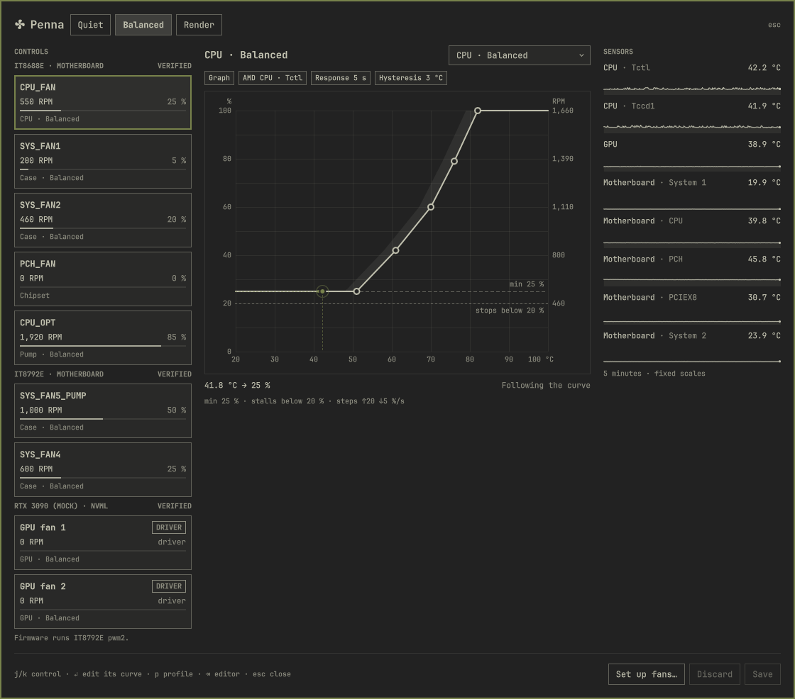
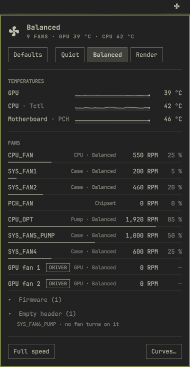

# Penna

Fan control for Linux, made to be understood.

Penna is a daemon (`pennad`), a command line (`penna`) and a shell plugin for [Omarchy](https://omarchy.org). It names every
fan for what it cools, shows its RPM beside what it was asked for, and says plainly what a machine can't do. It drives fans
only through the kernel's own drivers, hwmon and NVIDIA's NVML, and never touches a chip from userspace.

- **Every fan goes back.** Before Penna changes a fan it writes down how to put it back. A clean stop, a crash, `kill -9`, a
  hung loop caught by systemd's watchdog, and removing the package all return each fan to its BIOS or driver. *Defaults*, the
  first profile, does the same whenever you choose it.
- **Setup measures, then proposes.** One automatic run of about five minutes writes to every fan, finds which header drives
  which tach, and suggests each fan's role: CPU cooler, pump, chipset, case or GPU. It measures where each fan stops and starts
  and how fast it spins. Then it proposes Quiet, Balanced and Render curves for you to review. Nothing is kept until you press
  *Save*.
- **Plain words.** Each fan says what kind of control it has (a duty, fixed levels, a target speed, a curve the firmware runs,
  or only automatic and full speed), and how well Penna knows its driver.

The design, and the reasoning behind every rule, is in [DESIGN.md](DESIGN.md).





The **popup** is for every day: the profile, the temperatures the curves follow, and every fan with its role, RPM and duty.
The **studio** is for curves: one card per fan, the editor with the fan's own stall line and RPM scale, and five minutes of
every sensor. Both take their colours from the shell's theme. These show a simulation of the desk Penna was built on, after
setup measured it and its curves were saved.
<br clear="right">

## Status

This is the first public release, 0.10. Penna runs every day on the desk it was built on: a Gigabyte X570 AORUS PRO, whose
ITE IT8688E and IT8792E chips run seven fans through the [it87 fork](https://github.com/frankcrawford/it87), plus an RTX 3090
through NVML. Every way out has been tested on that hardware.

Everything else is built from the kernel's source and documentation and tested in a simulator, on a model of each driver:

| Driver | Hardware | Penna can | Tier |
|---|---|---|---|
| `it87` | ITE Super I/O (Gigabyte and others) | set a duty | Verified |
| NVML | NVIDIA GPUs, proprietary driver | set a duty | Verified |
| `nct6775`, `nct6683`, `f71882fg`, `w83627ehf` | Nuvoton, Fintek and Winbond Super I/O | set a duty | Documented |
| `amdgpu` | AMD GPUs; RDNA4 through its OverDrive curve | set a duty, or write the curve | Documented |
| `nouveau` | NVIDIA GPUs, open driver | set a duty | Documented |
| `thinkpad_acpi` | ThinkPads | pick one of 8 levels, under a watchdog | Documented |
| `dell-smm-hwmon` | Dell laptops | pick one of 3 levels | Documented |
| `asus-wmi` | ASUS laptops | automatic or full speed; write the firmware's curves | Documented |
| `hp-wmi` | HP laptops | automatic or full speed | Documented |
| `lenovo-wmi-other`, `applesmc` | Lenovo laptops, Intel Macs | set a target speed | Documented |
| `cros_ec_hwmon`, `gpd-fan`, `acer-wmi` | Framework, GPD, Acer | set a duty | Documented |
| `alienware-wmi`, Legion | Alienware, Lenovo Legion | read only | Documented |

On a laptop whose fans Penna can't drive, its profiles switch the power profile instead, through power-profiles-daemon.

*Documented* means nobody has run Penna on that hardware yet. If you have one of these machines, a [machine
report](CONTRIBUTING.md#a-machine-report) is the most useful thing you can send.

## Install

On Arch Linux and Omarchy, from the AUR:

```
yay -S penna                                  # or paru -S penna
sudo systemctl enable --now pennad            # the first start adopts nothing: every fan stays with its firmware
sudo usermod -aG penna "$USER"                # change fans without root; applies at once
omarchy plugin add https://github.com/PushMotta/omarchy-penna.git --enable
penna doctor                                  # what stands between this machine and Penna running its fans
```

Then click the fan glyph in the bar and choose *Set up fans…*, or run `penna setup` in a terminal.

`penna doctor` names anything missing, with one thing to do about it and its risk. The usual one on Gigabyte boards is that the
stock `it87` doesn't know the chip: the fork, `it87-dkms-git`, does. Penna recommends it but never depends on it.

To build from this repository instead: `cd packaging && makepkg -si`.

### Removing it

`sudo pacman -R penna` stops `pennad` first, which hands every fan back. `penna reset` puts every fan back at any time. As
root it works without the daemon. Remove the plugin with `omarchy plugin remove io.github.pushmotta.penna`.

## Using it

The **bar glyph** shows the fans' state at a glance. Click it for the **popup**: profiles, temperatures, every fan with its
RPM, and *Full speed*. *Curves…* opens the **studio**: one card per fan, the curve editor, and setup.

The **command line** does everything the shell does:

```
penna watch                    # live table of temperatures and fans
penna profile quiet            # switch profile, and keep it
penna profile defaults         # every fan back to its BIOS or driver, and kept there
penna set "CPU cooler" 70 --for 30s
penna full-speed on|off
penna identify "SYS_FAN1"      # 100 % for 3 s, to find a fan by ear
penna setup                    # measure every fan and propose curves
penna events                   # takes, hand-backs, failsafes and emergencies, as they happen
penna waybar --follow          # a Waybar custom module, outside Omarchy
penna capture                  # a machine report's tarball; read-only, no root
```

## How it keeps fans safe

`pennad` runs as root under systemd, with a hardened unit and a 5 s watchdog. Surfaces talk to it over a local socket,
`/run/penna/penna.sock`, and only members of the `penna` group may change anything. Before its first write to a fan it records
how to put that fan back in `/run/penna/held.json`. The unit's `ExecStopPost` runs `penna restore` from that file, so the fans
go back however `pennad` ends. A sensor that stops reading sends its fans to 100 %. A CPU or GPU past its emergency limit
sends every fan Penna runs to 100 % until it has cooled 5 °C below the limit. The details are DESIGN.md §6.

## Development

```
cargo run -p pennad -- --mock render-burst --forever        # a simulated desk, unprivileged
cargo run -p pennad -- --mock faults --speed 10             # every fault Penna must survive, ten times faster
cargo run -p pennad -- --mock test/fixtures/drivers/thinkpad.toml --forever   # any driver's simulated machine
cargo run -p penna -- watch                                 # talks to whichever pennad answers
cargo test --workspace
cd plugin && node --test test/model.test.js test/studio.test.js
```

The tests never touch real fans. [CONTRIBUTING.md](CONTRIBUTING.md) says how to send a machine report or a change.

## License

MIT. See [LICENSE](LICENSE).
